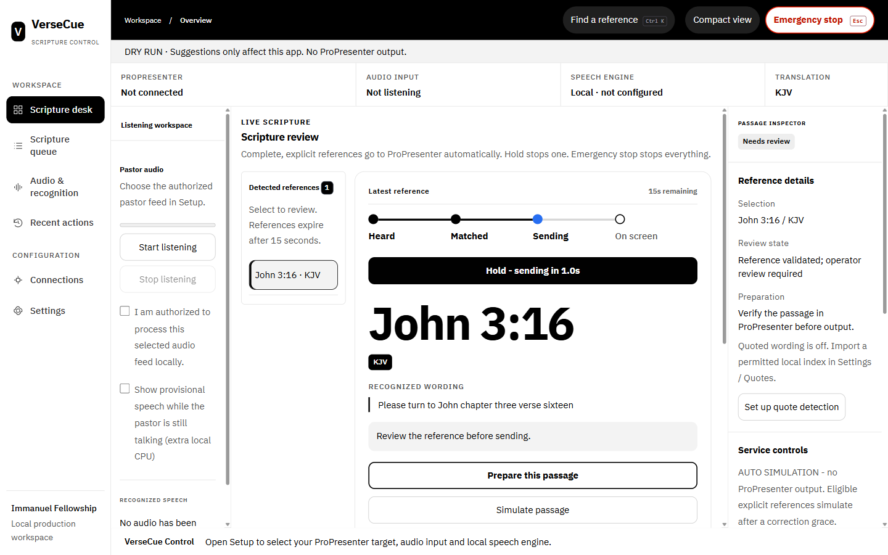

# VerseCue

**A Scripture assistant for the church production booth.**

VerseCue listens to an authorized pastor audio feed, identifies Bible references and helps an operator review and send prepared passages to ProPresenter. Built for Immanuel Fellowship Church, it works alongside ProPresenter while ProPresenter keeps control of Bible text, themes, Looks and screens.



## Download

**Current downloadable development version: 0.6.0.** This is a supervised-test build, not an approved live-service release.

| Computer | Download | Status |
|---|---|---|
| Windows, Intel/AMD 64-bit | [Download Windows ZIP](https://github.com/gboyegaadeojo/VerseCue/releases/download/v0.6.0/VerseCue-0.6.0-win32-x64.zip) | Packaged desktop scenarios passed; Auto sent a saved test passage to a personal ProPresenter 21.4.2 with Audience and Stage off |
| Mac, Apple Silicon (M1/M2/M3/M4) | [Download Mac Apple Silicon ZIP](https://github.com/gboyegaadeojo/VerseCue/releases/download/v0.6.0/VerseCue-0.6.0-darwin-arm64.zip) | Native CPU speech build, local signature verification and packaged workspace check passed; Mac Bible preparation and church-device acceptance pending |

[All release files and checksums](https://github.com/gboyegaadeojo/VerseCue/releases/tag/v0.6.0). Do not use the automatically generated source-code ZIP as the installed application. Older builds remain on the [releases page](https://github.com/gboyegaadeojo/VerseCue/releases).

Windows: extract the **entire ZIP**, then open **VerseCue.exe** inside the extracted folder. Keep its supporting files together. The Windows package includes the verified local speech engine and model. It is not signed by a trusted software publisher, so Windows may warn you.

Mac: extract the ZIP and move **VerseCue.app** to Applications. The package is for **Apple Silicon (M1/M2/M3/M4)** and includes the local speech engine and model. It is ad-hoc signed, not Developer ID signed or notarized, so Gatekeeper may block it. Intel Mac builds are not provided.

To go back to an earlier build or remove VerseCue, see [rollback and removal](docs/125-rollback-and-uninstall.md).

## What it does

- Listens to an authorized pastor feed and recognizes explicit English references, such as "Please turn to John chapter three verse sixteen."
- **Starts in Auto (dry run).** Complete, explicit show/read references go to ProPresenter automatically once you have armed test output and approved the prepared passage for Auto. Anything ambiguous, quoted, corrected, slow or unprepared waits for review.
- **Hold** (press **H**) stops one pending automatic send; **Emergency stop** (**Esc**) stops everything.
- Shows the latest reference with a Heard → Matched → Sending → On screen progress line, in a high-contrast workspace with Standard or Large text.
- Prepares the passage through ProPresenter's own Bible tool on Windows, so ProPresenter keeps the Bible text, themes and Looks.
- Uses local speech recognition with no paid cloud service, and keeps working while minimized.

## First test

Follow the [personal test guide](docs/124-personal-auto-first-test-guide.md). In short:

1. Use a personal ProPresenter with **Audience and Stage outputs turned off**. Never the church's live system.
2. Open VerseCue. It shows **DRY RUN** and **AUTO SIMULATION**: nothing reaches ProPresenter.
3. In **Settings**, connect to ProPresenter (`127.0.0.1`, port `1025`), choose your microphone and channel, and run the 10-second input test.
4. Start listening and say "Please turn to John chapter three verse sixteen", then pause. The reference appears, shows **Sending**, then **Simulated**.
5. Press **H** while it says Sending to hold it, and **Esc** to test Emergency stop.

## Modes in plain language

| Mode/state | What happens |
|---|---|
| Dry run | Recognition and review work, but sends are simulated. Nothing reaches ProPresenter. This is the startup state. |
| Auto (startup default) | Complete, explicit references send automatically after a short hold window, but only when output is armed and the passage is approved for Auto. Otherwise they simulate or wait for review. |
| Confirm | An operator reviews and explicitly confirms each passage. Choose it as the start mode in Settings if you prefer. |
| Suggest only | References are offered for review; sending is blocked. |
| Paused / Emergency stopped | Recognition and output are paused or blocked. Resuming returns to Confirm; Auto is re-enabled deliberately. |

## Limits of the 0.6.0 build

- Trusting Auto in a real service needs the ten-hour rehearsal with labelled real sermon recordings ([docs/117](docs/117-auto-rehearsal-harness.md)) and measured accuracy. That has not been done.
- On a typical computer, recognition takes about 2 seconds per speech chunk, so verses appear about 3-4 seconds after the pastor finishes, plus the 1-second hold.
- Automatic sends use KJV numbering. Other editions need review. Preparation through ProPresenter's Bible window is Windows-only; Mac preparation is not built yet.
- "ProPresenter confirmed" means ProPresenter's own readback matched. It does not prove what the room or stream saw.
- Real MOTU routing, church computers, physical screens and Looks, Companion and media alongside VerseCue, and volunteer testing remain pending. This build is not a claim of Sunday-service readiness.

See [what remains](docs/107-remaining-work-and-acceptance.md) and the [original requirement audit](docs/99-original-requirement-evidence-audit.md) for the full list.
## Quick controls

- **Ctrl/Cmd+K:** focus manual reference in the full workspace.
- **Alt+1-4:** Overview, Scripture queue, Audio & recognition, Recent actions.
- **Enter in the reference field:** review a reference; never send it.
- **Escape:** Emergency Stop while VerseCue has focus.

## Privacy and Bible content

Audio is processed locally. Audio/transcripts are not recorded persistently by default; the default worker uses bounded temporary recognition files which are cleaned up after processing. No Bible translation corpus is bundled or downloaded. Import only passage text you have permission to use. The private API starts disabled and uses a session-only local token.

## For developers

### Continuing development

Developers and coding agents: start with [CLAUDE.md](CLAUDE.md), the detailed [handoff](HANDOFF.md), and the [remaining-work list](docs/107-remaining-work-and-acceptance.md). These record verified progress, the next action and outstanding service acceptance.

Use a current compatible Node.js installation and the pinned dependencies in the lockfile. On Windows use npm.cmd if PowerShell blocks npm.ps1.

```sh
npm ci
npm start
npm test
npm run check
npm run test:desktop
```

[Contributing and PR workflow](CONTRIBUTING.md) | [Current progress](PROGRESS.md) | [Implementation coverage](docs/implementation-coverage.json) | [Setup and release evidence](docs/22-development-build-and-release-status.md) | [Workspace guide](docs/50-premium-studio-workspace.md) | [Prepare and save a Bible copy](docs/46-native-saved-bible-preparation.md) | [Spoken next-verse plan](docs/48-spoken-next-verse-plan.md) | [Preaching workflow review](docs/49-preaching-workflow-gap-review.md).

Application improvements use focused pull requests so changes can be reviewed and reverted independently. Merging a PR updates source; it does not automatically replace an already downloaded app. Download a newer build only when its application contents/version change. Version 0.5.5 includes merged PRs #2-10, including expanded citation forms, smoother updates, translated saved-cue browsing and offline IBM Plex Sans.

## Project documentation

[Start with the leadership summary](docs/00-executive-summary.md), [operator runbook](docs/13-operations-and-runbook.md), or [requirements summary](REQUIREMENTS_SUMMARY.md). The [master specification](VerseCue_Master_Development_Prompt_v2_Codex.md) is authoritative. [Assumptions](PROJECT_ASSUMPTIONS.md), [research sources](RESEARCH_SOURCES.md), [change requests](NEW_REQUESTS.md) and [historical development notes](DEVELOPMENT_HISTORY.md) remain available. The [CSV](docs/test-data/versecue-utterances.csv) and [JSON](docs/test-data/versecue-utterances.json) retain all 66 matching synthetic test proposals.

## Ordered document package
| Order | Document | Review purpose |
|---|---|---|
| 00 | [Executive summary](docs/00-executive-summary.md) | Nontechnical business case, costs/risks/scope and names |
| 01 | [Business requirements](docs/01-business-requirements.md) | Stakeholders, six objectives/BRs, journeys, KPIs and gates |
| 02 | [Functional requirements](docs/02-functional-requirements.md) | 62 numbered detailed FRs with acceptance/owners/releases |
| 03 | [Non-functional requirements](docs/03-non-functional-requirements.md) | 24 measured NFRs, profiles and thresholds |
| 04 | [Technical requirements and architecture](docs/04-technical-requirements-and-architecture.md) | Provisional stack, C4/state diagrams, contracts/queues/deployment |
| 05 | [UX requirements](docs/05-ux-requirements.md) | Four ASCII layouts, modes, focus, Sunday flow and recovery |
| 06 | [Test and acceptance plan](docs/06-test-and-acceptance-plan.md) | Unit/contract/system/soak/HIL/UAT, dataset and go/no-go |
| 07 | [Risks and open questions](docs/07-risks-and-open-questions.md) | Ranked risks, decision owners and due points |
| 08 | [Roadmap](docs/08-roadmap.md) | P0 → MVP → v1 → optional v2, preliminary effort/costs |
| 09 | [Investigation findings](docs/09-investigation-findings.md) | Primary-source STT/framework/parser/content comparisons |
| 10 | [Integration feasibility and POC](docs/10-integration-feasibility-and-poc.md) | Route matrix, pending tests, exact evidence limitations, gate |
| 11 | [Privacy, security and licensing](docs/11-data-privacy-security-and-licensing.md) | Inventory/retention, 16 hazards, controls and rights ledger |
| 12 | [Traceability matrix](docs/12-traceability-matrix.md) | Objective/BR → each FR/NFR → tests/release |
| 13 | [Operations and runbook](docs/13-operations-and-runbook.md) | Preflight, five-minute guide, manual failback and incidents |
| 14 | [Decision records](docs/14-decision-records.md) | Options, recommendations/accepted constraints and consequences |
| 15 | [Implementation handoff](docs/15-implementation-handoff.md) | Post-gate repo/modules/tasks/readiness/done, no code |
| 16 | [Decision brief](docs/16-decision-brief.md) | Compact final review and next engineering step |
| 17 | [Package audit](docs/17-package-audit.md) | Completeness/consistency evidence and remaining verification |
