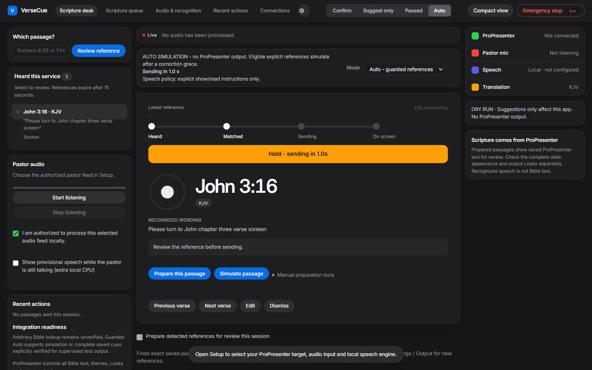

<p align="center"></p>

# VerseCue

**Free, local Bible-reference cueing for ProPresenter.**

VerseCue listens to the preacher, recognises Bible references as they are spoken (and well-known verses when they are quoted), and gets the passage into ProPresenter. It can send it automatically, ask you to confirm first, or open it ready for a volunteer to take live. Speech recognition runs on your own computer: no cloud service, subscription or account.

ProPresenter stays in charge of your Bible text, themes, Looks and screens. VerseCue only tells it what to show.



> **Status: development preview.** VerseCue works and is tested, but it hasn't yet been proven in long live services. Try it on a personal or test ProPresenter first, with your audience screens off, before relying on it on a Sunday.

## Who it is for

Churches and ministries that use **ProPresenter** (tested with ProPresenter 21.4 on Windows) and want Scripture on screen as soon as it's read, without a volunteer searching for every reference.

You need:
- **Windows 10/11 (64-bit)** or a **Mac** (Apple silicon or Intel). For the most accurate recognition, use an Apple silicon Mac (M1 or newer) or a PC with a graphics card such as an NVIDIA RTX; other computers still work with a smaller model.
- About **1 GB** of free disk space.
- **ProPresenter** with its network API turned on (ProPresenter > Settings > Network).
- The **preacher's microphone feed** going into the computer, for example through an audio interface such as a MOTU M4, or a USB microphone for testing.

## Download

**Latest version: 0.6.9** (development preview)

| Computer | Download |
|---|---|
| Windows (Intel/AMD 64-bit) | [VerseCue installer (recommended)](https://github.com/gboyegaadeojo/VerseCue/releases/download/v0.6.9/VerseCue-Setup-0.6.9.exe) or [ZIP](https://github.com/gboyegaadeojo/VerseCue/releases/download/v0.6.9/VerseCue-0.6.9-win32-x64.zip) |
| Mac with Apple silicon (M1 or newer) | [Disk image (recommended)](https://github.com/gboyegaadeojo/VerseCue/releases/download/v0.6.9/VerseCue-0.6.9-darwin-arm64.dmg) or [ZIP](https://github.com/gboyegaadeojo/VerseCue/releases/download/v0.6.9/VerseCue-0.6.9-darwin-arm64.zip) |
| Mac with Intel processor | [Disk image (recommended)](https://github.com/gboyegaadeojo/VerseCue/releases/download/v0.6.9/VerseCue-0.6.9-darwin-x64.dmg) or [ZIP](https://github.com/gboyegaadeojo/VerseCue/releases/download/v0.6.9/VerseCue-0.6.9-darwin-x64.zip) |

Checksums and older versions are on the [releases page](https://github.com/gboyegaadeojo/VerseCue/releases). Don't use GitHub's automatic "Source code" ZIP to run the app.

- **Windows installer:** run **VerseCue-Setup**. It installs VerseCue for your Windows user without administrator rights, and adds Start-menu and desktop shortcuts. Remove it later from **Settings > Apps**, which asks whether to keep your settings. Installing a newer version replaces the old one.
- **Windows ZIP:** extract the whole ZIP, then open **VerseCue.exe** in the extracted folder.
- **Mac disk image:** open the **.dmg** and drag **VerseCue** onto **Applications**.
- **Mac ZIP:** extract the ZIP and move **VerseCue.app** to Applications.

The app isn't signed by a registered publisher yet. Windows may show a SmartScreen warning: choose **More info > Run anyway**. On a Mac, right-click VerseCue and choose **Open** the first time.

To remove VerseCue or go back to an earlier version, see [rollback and removal](docs/125-rollback-and-uninstall.md).

## What VerseCue can do

### Hears the Bible references a preacher speaks
- **Natural speech:** "Turn with me to Proverbs chapter three, verse five", "John 3:16", "Psalm 119 verse 105".
- **Ranges:** "John chapter three verses sixteen through eighteen", "First Corinthians thirteen four to seven".
- **Numbered books, said any common way:** "1st Peter", "First John", "Second Timothy", even with a pause after the number. Common alternative names work too, such as "Psalms" for Psalm and "Song of Solomon".
- **Forgiving with hard names:** when the speech engine spells a book slightly wrong ("Habakuk", "Zeccariah"), VerseCue still recognises it before chapter or verse wording. It always asks a person to check these; Auto never sends them.
- **Whole chapters:** "Romans chapter eight".
- **Corrections:** "sorry, I meant John 3:17" replaces the previous reference.
- **Following along:** "next verse", "previous verse", "next chapter", "go back two verses", "verse 18" (in the same chapter), "read that again".
- **Several references in one sentence**, each shown separately for review.
- **References split by a pause:** "Romans eight… verse twenty-eight" is joined back together.
- **Spoken "hold" instructions:** "hold that", "wait", "don't change it".
- **Repeats suppressed:** a reference mentioned again a few seconds later is not shown twice.

### Recognises quoted Scripture
- **Quotes without a reference:** when the preacher quotes a verse without saying where it is ("Trust in the Lord with all thine heart…"), VerseCue can find it (Proverbs 3:5).
- **Free Bibles for matching:** it uses the free, public-domain King James and World English Bibles to recognise the wording, prepares the verse in your own installed translation, and labels it "matched from quoted wording".

### Switches Bible version on request
- **Version requests:** "can you give me NIV", "read that in New King James" or "1st Timothy 1 verse 2 in NIV" reopens the passage in that version.
- **Checked first:** VerseCue first checks the version is installed in ProPresenter. If it isn't, VerseCue says so and keeps the current version.
- **No waiting to check:** VerseCue reads which versions are installed while it opens the first chapter, so a later version request goes straight through.
- **Spoken names it understands:**
  - KJV / King James
  - NKJV / New King James
  - NIV / New International Version
  - ESV / English Standard
  - AMP / Amplified, and AMPC / Amplified Classic
  - The Message
  - ASV / American Standard
  - NLT / New Living

### Gets the passage into ProPresenter your way
- **Auto:** complete, explicit references go to ProPresenter after a short hold window you can set. Press **H** to hold one.
- **Confirm:** you review each passage, then send it.
- **Prepare for volunteer:** VerseCue never sends anything. It opens the passage in ProPresenter's own Bible view, by default the whole chapter at the spoken verse, and your volunteer takes it live and uses ProPresenter's next/previous. A whole chapter opens faster because VerseCue skips the clipped-text check that exact passages get; your volunteer sees each slide before taking it live.
- **Starts before the sentence ends:** in Prepare for volunteer, when the preacher names a passage and keeps talking, VerseCue starts opening the chapter straight away instead of waiting for a pause. If the finished sentence names something else, it opens that instead. You can turn this off in **Settings > Output**.
- **Stays ready:** VerseCue keeps its ProPresenter helper and the speech model loaded during the service, so each passage doesn't wait for them to start again.
- **Suggest only and Paused,** plus **Emergency stop (Esc)** to stop everything at once.
- **Your own slides:** uses passages you have saved in ProPresenter's library. Long passages split into parts you continue deliberately. Previews of the slides come from ProPresenter itself.
- **Long readings:** up to 176 verses, a whole chapter, in Confirm. Auto stays at 10 verses.

### Shows what it heard and how sure it is
- **Most accurate speech model on a graphics chip:** VerseCue includes Whisper Large-v3-turbo, which copes much better with accents, and uses it automatically on Apple silicon Macs and PCs with a graphics card. Computers without a working graphics chip use the smaller base.en model so they stay fast.
- **Quick after each pause:** VerseCue starts recognising a phrase while it waits to confirm the speaker has paused, so a reference is ready about 0.8 s after the last word on a graphics card.
- **Works minimized:** VerseCue keeps listening, detecting and preparing while minimized or behind a full-screen ProPresenter.
- **Always the current speech engine:** each new version of VerseCue switches to the speech engine and model it ships with on its first start, so an update never keeps using files from an older copy.
- **Live transcript strip:** the last few phrases heard, newest first in full colour; silence and music markers are hidden.
- **Clarity badge:** each reference gets "Heard clearly", "Likely" or "Check this", with a percentage.
- **Progress line:** Heard, Matched, Sending, On screen.
- **"Heard this service" list:** what was said and whether it was spoken or quoted.
- **Accuracy check:** in **Settings > Speech**, read about 55 short phrases and VerseCue scores what it heard on your voice, microphone and computer. It also tests optional **book-name hints** (off by default, slower) and tells you whether to turn them on. Nothing is sent to ProPresenter, and recordings are saved only if you choose.

### Ready out of the box
- **Connects by itself:** connects to ProPresenter automatically and keeps trying. Usually the only setting is ProPresenter's address.
- **Listens straight away:** uses the computer's default microphone and starts listening when it opens.
- **Pastor's own input:** choose a specific input and channel, such as the pastor's channel on a MOTU M4 or another interface, with a 10-second level test. VerseCue warns if an input looks like computer audio instead of a microphone.
- **Free, local speech recognition:** the model stays loaded and recognition starts 0.7 s after the preacher pauses.
- **Uses the graphics card automatically:** any AMD, NVIDIA or Intel card on Windows (Vulkan) and Metal on Macs, warming up in the background. An optional NVIDIA CUDA setup is also available.

### Built for the production booth
- **Calm design:** a dark workspace with a **Large "booth distance"** text size, a **compact always-on-top window**, and keyboard shortcuts.
- **Saved setups:** **service profiles** for different setups, **automatic settings backups** with restore, and settings import/export.
- **Stays safe when things go wrong:** connection health shows "slow to respond" and pauses safely if ProPresenter is lost. VerseCue recovers safely after the computer sleeps.
- **Support:** a quiet **new version notice** (never while listening; it only tells you, you choose whether to download), **redacted diagnostics** you can send for help, a **downloaded-update checker** that verifies a release before you install it, and an optional **private local API** for your own tools (off by default, protected by a token).

### Runs where you are
- **Windows and Mac:** Windows 10/11 and Macs (Apple silicon and Intel).
- **Any ProPresenter version:** works with ProPresenter's network API. Opening passages in ProPresenter's Bible view is verified on Windows; Mac support is being verified.
- **No cloud:** no account, subscription or internet connection needed to run.

## Help inside the app

Press **?** in the toolbar, or in Settings, to see a numbered explanation for every button and tick box on that page. A short guided tour runs the first time VerseCue opens, and you can replay it from the help panel.

## Getting started

1. **Use a test setup first.** Open ProPresenter with your **Audience and Stage screens turned off**.
2. **Open VerseCue.** It starts in a safe **dry run**: everything works, but nothing is sent to ProPresenter.
3. **Connect ProPresenter.** VerseCue tries the usual address (`127.0.0.1`, port `1025`) on its own and keeps trying. If ProPresenter is on another computer or uses a different port, enter them in **Settings > ProPresenter**. This is the only setting you need.
4. **Everything else is ready.** VerseCue uses the computer's default microphone and starts listening when it opens. It warms up the graphics card in the background, using the processor until the card is ready. To use a different input, such as the preacher's channel on an audio interface, choose it in **Settings > Audio** and run the 10-second input test.
5. **Start listening** and say "Please turn to John chapter three verse sixteen", then pause. The reference appears with its badge and progress.
6. When you're comfortable, choose your mode (Auto, Confirm or Prepare for volunteer), arm output and test with a real passage, still with the screens off.

A fuller walkthrough is in the [personal test guide](docs/124-personal-auto-first-test-guide.md).

## Before each service (Windows)

**Restart ProPresenter before the service starts.** On Windows, VerseCue opens passages by reading ProPresenter's screen, the way accessibility tools do, so it can confirm what ProPresenter opened. After that, ProPresenter does extra background work for the rest of its session, which makes later steps slower. A fresh start each service keeps it fast. If ProPresenter becomes too slow to respond, VerseCue stops before clicking or typing anything and asks you to restart ProPresenter.

## Safety by design

- Starts in dry run every time. Sending to ProPresenter needs deliberate setup.
- **H** holds one automatic send; **Esc** (Emergency stop) stops everything.
- Auto sends only complete, explicit references, at most 10 verses, from passages you approved. Anything unclear, quoted, corrected or slow waits for a person.
- If the connection drops, output is disarmed and VerseCue pauses.
- VerseCue never clears ProPresenter, never deletes anything and never changes ProPresenter's settings.

## Privacy

Audio is processed on your computer and isn't saved. Temporary recognition files are kept in VerseCue's own folder, deleted after each phrase and, after a crash, deleted at the next start. The diagnostics export holds only event codes and timings, never what was said. While VerseCue runs, the operating system may write memory to disk (page file, hibernation), so use full-disk encryption (BitLocker or FileVault) on the service computer. VerseCue needs no account or internet connection, except for downloading it and, if you choose, the optional NVIDIA engine files. The one request it makes itself is the **new version notice**: about twice a day, and never while listening, it reads the public list of VerseCue releases on GitHub. It sends nothing about you, your computer or your services, and downloads nothing. Turn it off in **Settings > Advanced > New version notice** and VerseCue makes no internet requests at all. Bible text comes from ProPresenter. The bundled public-domain Bibles are used only to recognise quoted wording.

## Current limits

- Real-world accuracy across many preachers, accents and rooms is still being measured. Treat Auto as supervised until you have tested it in your own setting.
- Opening passages in ProPresenter's Bible view (Prepare for volunteer) is verified on Windows. The Mac version is being verified.
- Recognition speed depends on the computer. A graphics card makes it much faster.
- Automatic sends use King James verse numbering. Other editions are reviewed by a person.

## Keyboard shortcuts

| Key | Action |
|---|---|
| **H** | Hold the pending automatic send |
| **Esc** | Emergency stop |
| **Ctrl/Cmd+K** | Type a reference |
| **Alt+1–4** | Switch workspace pages |

## For developers

VerseCue is an Electron app with a local whisper.cpp speech engine and ProPresenter's HTTP API. Start with [CLAUDE.md](CLAUDE.md), the [handoff](HANDOFF.md) and the [remaining-work list](docs/107-remaining-work-and-acceptance.md).

```
npm ci
npm test          # module tests
npm run check     # syntax, dependency inventory and SBOM
npm start         # run from source
```

Third-party licences are in [legal/](legal/).

## License

VerseCue is open source under the [MIT License](LICENSE). Bundled third-party components keep their own licences, listed in [legal/](legal/).
