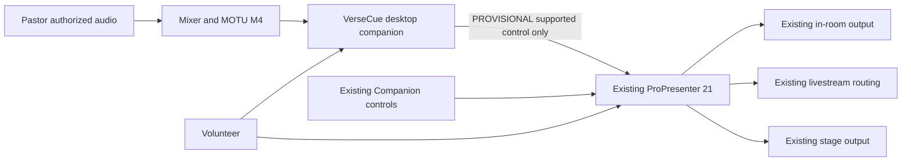
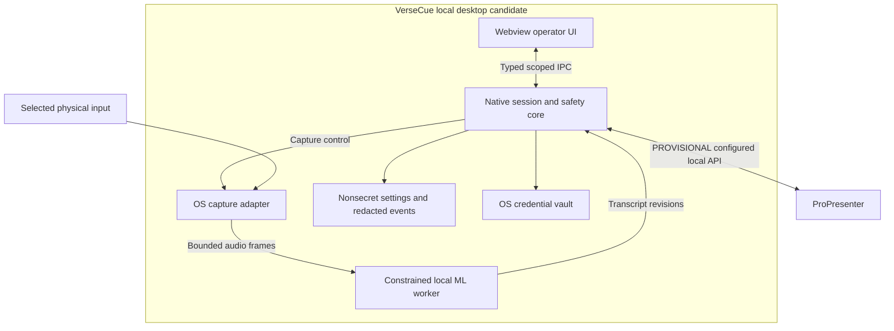
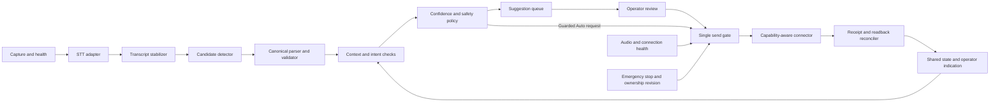
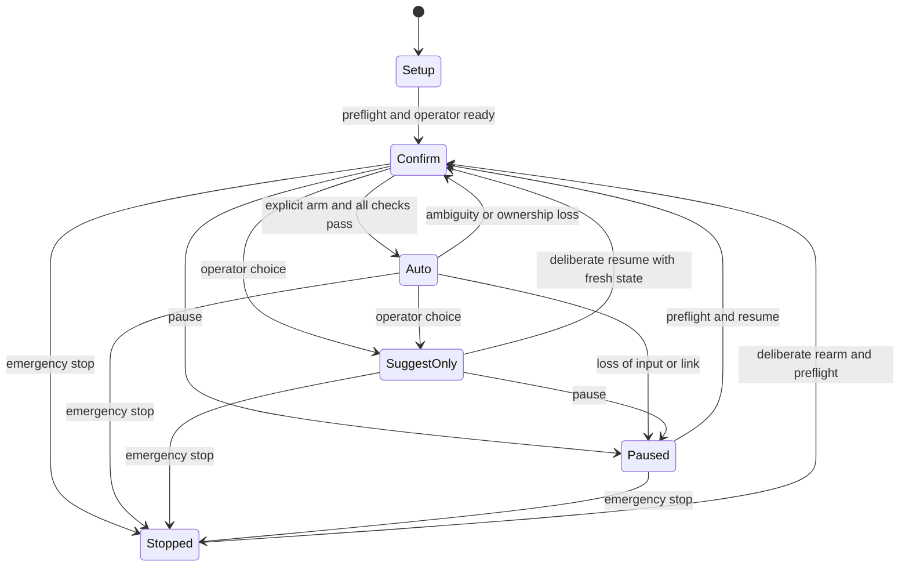
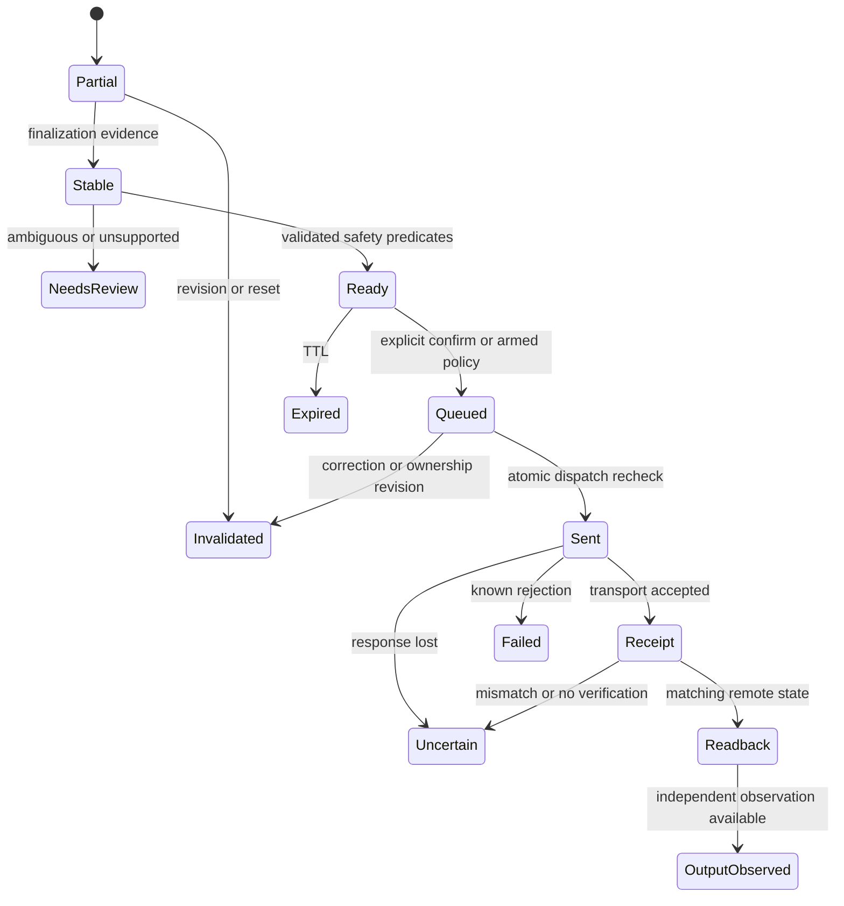

# Technical requirements and architecture candidate

2026-11-17. **PROVISIONAL throughout: P0 is PENDING.** This document preserves the original candidate design. Under later explicit user implementation approval, an Electron development application was built; see [actual development architecture, tests and limits](22-development-build-and-release-status.md) and ADR-013. The Tauri/native-core proposal below is not the implementation in the current build. Requirements FR-001–062/NFR-001–024 remain authoritative; no full release acceptance is inferred.

## Architecture decisions and deployment
Recommend evaluation of a Tauri 2 OS-webview shell, Rust/native core, native capture bridge and constrained whisper.cpp worker, deterministic parser and independent capability-aware connector. These are candidates; no dependencies/toolchain selected. Electron remains a fallback for proven capture/accessibility/team-fit problems; Avalonia/MAUI alternatives are compared in docs/09. UI is native-feeling installable desktop, not native OS widgets. No web service or cloud account required. Do not couple parser/command policy to a provider or infer Bible capabilities from presentation APIs.

Same-PC first: Mac mini M4 hosts ProPresenter 21, Companion and VerseCue; MOTU M4 provides selected clean pastor channel without changing desk routing. CPU/GPU/ANE contention with media is a P0 concern. Loopback is optional future OS-specific work, not a universal microphone substitute. LAN variant: approved companion captures authorized feed and talks only to configured PP host on trusted wired network. Audio does not automatically stream across LAN; physical/authorized audio routing must be specified. UI automation fallback would require a host-local agent and new reviewed architecture; it is not silently included. Windows x64, Apple Silicon and Intel packaging/testing are separate tasks.

## C4 context view

## C4 container view

## C4 component view

## Flow, concurrency and timestamps
Capture callback does bounded work only: timestamp, copy/ring frame, meter counters. No inference/network/UI work there. Worker consumes at most 2 s queued audio, with a 10 s maximum transient ring including overlap. Overrun drops stale work, marks data gap, invalidates context/Auto and asks for input restart. Stable-transcript events carry session/utterance/revision IDs so a late worker message cannot resurrect dismissed/corrected content. Worker crash contains recognition failure while manual ProPresenter remains independent.

Core processes state changes serially; one command dispatcher owns all sends. UI windows cannot send directly. At most 5 active suggestions, one pending Auto candidate and one in-flight command. New unrelated reference cancels unsent Auto work. Multiple references are review-only. Candidate TTL 15 s uses monotonic stable-detection time; 120 s passage context TTL and 10 s duplicate cooldown are proposed defaults. Profile/target/translation/mode/ownership revisions invalidate old approvals. History N=20 is memory-only when v1 offered. Drop policies must be visible, not silent backlog.

Proposed health polling: 2 s interval, 1 s timeout, one outstanding health read; mark degraded immediately on timeout and offline after two misses, bound recognition of outage to 5 s by event/timeout scheduling. Reconnect health reads use 1/2/5/10 s capped backoff with jitter; writes have no automatic retry. Exact scheduling must pass NFR-008 rather than treating arithmetic as evidence. Disable automatic writes on first uncertainty. No mutation uses an assumed safe GET; request paths/capabilities are explicitly allowlisted. Output receipt deadline proposed 2 s; any ambiguous completion becomes uncertain, blocks further Auto, and requires reconciliation/intentional review. Local idempotency does not mean ProPresenter supports idempotency keys.

## State models

OutputObserved is optional evidence, not an assumed runtime capability. “Live” must not be shown when only receipt/readback exists. Emergency stop cannot retract a command already accepted; it blocks future sends and leaves actual output to the operator, never automatic Clear All.

## Data contracts (schema design only)
All contracts versioned; timestamps include monotonic session offset and optional UTC for sanitized operational logs. Reject unknown enum/schema versions at boundaries; size limits prevent hostile payloads. Content stays transient by default.

| Contract | Required fields and invariants | Lifetime / trust boundary |
|---|---|---|
| AudioInput | schemaVersion, sessionId, deviceId, displayName, channelMap, sampleRate, sampleFormat, frameSequence, capturedAt, duration, rms/peak, health, droppedFrames | OS callback → worker; selected ID only, bounded 10 s ring, no disk by default. |
| TranscriptionEvent | sessionId, utteranceId, revision, text, partial/final status, start/end/captured/received times, provider/model/version, language, optional providerConfidence, finalizationEvidence | Worker → core; max event text 8 KiB, ordered revisions, no cross-session reuse; 2 min rolling RAM. |
| ScriptureCandidate | candidateId, revision, rawPhrase/span, canonicalBookId, chapter/startVerse/endChapter/endVerse, translationRequest/installedId, contextId/relation, parseEvidence, heuristicClass, ambiguityFlags, intentPolicy, detected/stable/expiresAt, validationVersion | Parser → policy/UI; exact bounds, ambiguity explicit, no silent missing-verse inference. |
| PassageContext | contextId, canonical reference, translationId, origin manual/remote/observed, verifiedAt, expiresAt, targetRevision, remoteStateFingerprint, validity | Reconciler → parser; relative resolution only with valid provenance; reset on external change/loss. |
| DisplayCommand | commandId/idempotencyKey, candidateId/revision, origin manual/auto, targetId/revision, expectedReference/translation/theme/Look expectations, policy/config/ownership revisions, created/expires/queued/sent times, state | Policy → dispatcher; immutable expected tuple, one in-flight; cancel unsent on revision. |
| ConnectorCapabilities | installed app/build/API, transport, supportsArbitraryLookup/ranges/translation/theme/clear/readback, evidenceRef and verifiedAt for each | Setup → gate; unknown=false for automated operation, never infer capabilities from version alone. |
| Acknowledgment | commandId, receiptAt, transportStatus, readbackAt/match/status, outputObservation evidenceRef/time or absent, failureCode, uncertainReason | Connector → reconciler; transport success ≠ output success. |
| ErrorEvent | eventId, correlationId, UTC/sessionOffset, component/category/severity, safeCode, retryability, actionHint, versions; no default raw text/audio/token | Core → rotating redacted local logs; 7 d/20 MB cap; IP/path redaction on export. |
| SettingsProfile | schemaVersion, profileId, selected input/channel, configured target/allowlist, selected installed translation, expected assets, TTLs/range limits, consent flags, vault references | Import validates bounds; cannot arm Auto or import plaintext secrets; preserve two safe backups. |

## Safety gate and confidence
Pseudocode policy, not application code: “Require current candidate/revisions, unexpired stable utterance, canonical/translation validation, verified route, healthy audio/link, permitted mode, target identity, safe ownership and no stop latch; require intentional confirmation or independently allowed Auto intent; atomically recheck immediately before dispatch.” No provider/parser/compact view can bypass this gate. Rechecks cannot perfectly close races with external Companion actions unless the installed route provides atomic arbitration; lack of reliable arbitration blocks Auto in contested state, and residual race remains explicit.

Heuristic classes: Needs review (ambiguity/incomplete/unsupported), Validated for review (canonical but intent/ownership uncertain), Auto-eligible (all hard predicates plus accepted policy/calibration). Do not show a large probability percentage. Calibration on real holdout set is required for any probability claim; a high score cannot compensate for invalid translation, stale context or missing output route.

## Recovery and deployment/security boundaries
- Speech changes mid-utterance: revise same utterance, invalidate superseded candidate/unsent command; never show unstable partial. Late response for canceled candidate is diagnostic only.
- ProPresenter/network offline: no sends, clear context/queue, mark pending receipt uncertain, return safe mode. Reconnect identity/readback/preflight before manual action; no automatic Auto restoration.
- Manual/Companion action: invalidate ownership and relative context, retain manual ProPresenter operation. Focused/active presentation state is evidence only; no universal lock assumed.
- Corrupt settings/worker crash/wake: safe setup or Confirm/Paused, no output mutation on startup, bounded restarts with visible reason.
- Cloud optional future: opt-in separate adapter with verified TLS/terms/region and vault secrets; disabled in free/local MVP, never silent failover.

Native capture bridge uses documented platform APIs selected during approved engineering; no driver/kernel extension assumed. UI loads local trusted assets, restricts IPC capabilities, validates payloads, disallows remote executable content and arbitrary shell/network requests. ML sidecar uses restricted stdio/private IPC and known binary/model hashes; no network listener by default. Credential vault access stays in core. Resource limits and crash behavior must be verified on both OSs.

Packaging candidate: separate Windows x64 installer; macOS arm64 and x64 or tested universal bundle including compatible native workers; runtime prerequisites checked offline. Pin supported OS/runtime versions only after current vendor review, including Windows 10 lifecycle exception decision. Request mic entitlement/usage description and permission explanations; automation/accessibility privileges only if separately approved fallback needs them, not as default installer requirements. Verify signatures for app/helper/models as applicable, notarize Mac bundle, test clean installs/uninstall. No purchase or signing account setup authorized.

MVP updates: manually install verified signed packages between services, retain previous safe package and nonsecret config backup. v1 signed update manifests/payloads with version/architecture/hash, staged verification, rollback and in-service lock. Hosting/channel choice unresolved. Never alter ProPresenter libraries/themes/macros or copy Bible text as part of install/update/uninstall.

Audit: C4 views, state diagrams, contracts, asynchronous boundaries, timing/queues/backpressure, same-PC/LAN variants, OS packaging and recovery specified. All numerical defaults are proposed/testable; exact connector route remains an explicit P0 blocker.

