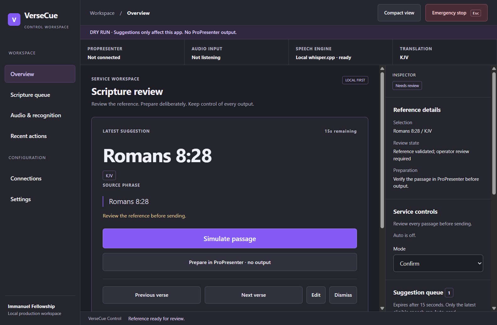

# Figma-inspired VerseCue Control workspace

2026-11-18 UTC. NR-004; definitive visual direction authorized by IFC. This supersedes Apple-inspired and Meta-inspired alternatives. The user-supplied reference files remain intact in `design-reference/`; they are visual inputs, not runnable production UI. Existing FR/NFR requirements and safety gates remain authoritative. P0 and service release acceptance remain PENDING.

## Operator workflow and information architecture

The desktop now uses a persistent left workspace navigator, compact real connection/audio/speech/translation strip, central Scripture review canvas and contextual right inspector. Neutral charcoal surfaces, purple selection/action accents, restrained borders, six-to-eight-pixel radii and consistent controls follow the Figma reference. No prototype connected statuses, sample Bible text, confidence percentages or assumed MOTU readiness are copied into the application.

| Destination | Purpose and available controls |
|---|---|
| Overview | Prominent reference and configured translation, source phrase, expiry, issue explanation, separate simulation/show and prepare-without-output actions; previous/next, edit, dismiss and manual reference review |
| Scripture queue | Existing bounded queue moved into a dedicated workspace; selecting a row returns to review and never sends output |
| Audio & recognition | Explicit audio authorization, selected feed, level meter, start/stop, local recognition explanation and in-memory rolling transcript |
| Recent actions | Existing bounded in-memory receipt history and deliberate Review again action; receipts never imply physical output confirmation |
| Connections | Direct shortcut to ProPresenter settings |
| Settings | Dedicated categorized settings dialog with existing settings/profile/import/export controls |
| Inspector | Current reference, review/stop/preflight state, preparation boundary, mode and Auto scope, suggestion queue and recent actions, integration limitations and reset |

Technical settings are physically organized into seven separate panels, not stacked under the service workspace: Profiles, ProPresenter, Audio, Speech, Output, Quotes and Advanced. Advanced holds the private local API and experimental Windows prepare-only workflow. All non-save buttons inside the settings form explicitly use `type=button`, preventing unrelated actions from submitting/saving settings. Existing control IDs, preload methods, connector, recognition, capture and session contracts remain unchanged.

## State truth and output prevention

Startup remains Confirm and dry run. The scope banner stays above the workspace; Stop stays in the header and is latched by the existing backend. Guarded Auto retains its explicit acknowledgment and simulation/test distinction; quotes remain Confirm-only. A large purple button says Simulate passage in dry run and Show prepared test cue only when test output is armed. Preparing in ProPresenter remains a distinct action explicitly labelled no output. Choosing navigation/settings/queue items never enables output, begins microphone capture or sends a cue.

Reference details show the actual candidate and issues. No candidate produces an explicit empty state. Source wording is labelled SOURCE PHRASE; it is not represented as exact Bible text. The explanatory preview boundary names the missing verified Bible text route. Output mapping verification, separate complete-single-cue Auto attestation, test-target consent and arming remain in Output settings. The experimental preparation consent remains in Advanced; requesting preparation without that consent opens the appropriate settings category.

Actual audio/speech/connection statuses continue to come from existing state and local device callbacks. Sleep/wake recovery, stale/invalid candidates, source ownership, cancel/reload/owner close, target-generation races and uncertain receipts retain their existing backend controls. No ProPresenter theme, Look, macro, live output or external configuration was changed by this redesign.

## Keyboard, compact view and scaling

Tab/Shift+Tab and native focused-button Enter/Space remain available. Manual-reference Enter creates a review candidate and never sends. Ctrl/Cmd+K focuses manual reference in the full workspace; Alt+1 through Alt+4 switches Overview, Queue, Audio and History. These navigation shortcuts do not override an open dialog, and are not registered globally in other applications. Escape retains Emergency Stop. Candidate arrival does not move keyboard focus.

Compact mode uses the same state and original IPC gate, with persistent Stop, Settings access, explicit mode control, scope banner, reference and review actions. The left navigator/inspector are omitted in compact mode. Full desktop canvas and inspector scroll independently while navigation, status and Stop remain available; narrow windows reflow into one column. Focus rings and textual states supplement color. Normal interactive controls retain at least 44px height. Reference text is 34�48px; auxiliary chrome is denser than the original booth-distance body-text proposal and still requires volunteer/readability acceptance. This is a dark-first implementation; a fully evaluated alternate light palette and real screen-reader/booth-distance acceptance remain pending.

## Implementation and verification

`ui/index.html` defines the reorganized semantic layout. `ui/style.css` defines dark-first tokens, responsive full/compact layouts and modal scaling. `ui/workspace.js` owns local navigation and settings category visibility; `ui/app.js` continues rendering backend state and handling the existing actions. No external font, CDN or renderer network dependency is introduced.

The focused `scripts/test-workspace.cjs` exercises queue selection without output, history receipts, navigation shortcuts, all seven settings panels, the Connections shortcut, 1280/900/640px horizontal fit, all settings at 200% zoom, persistent Stop and page-error absence. Enlarged-modal testing caught an inaccessible close control; percentage modal bounds and a sticky dialog heading fixed it. Existing desktop and background-quote tests were updated only to reach controls in their new settings destinations.

Source verification: all 170 existing tests, JavaScript syntax checks, desktop smoke, new workspace test, guarded Auto, minimized private-fixture recognition and quote confirmation, simulated power recovery, renderer recovery and old-target health-race checks passed. Synthetic recognition/fake loopback targets are explicitly distinguished from real microphone/ProPresenter tests. Development package version is 0.5.0; final packaged results and source/manifest hashes are recorded in [build verification](evidence/development-build-verification.json). Screenshots generated in ignored `test-results/` are local visual QA artifacts.

No actual microphone, live/church ProPresenter, physical output observation, Mac/M4, Companion/media concurrency, held-out speech accuracy or service-release acceptance was performed in this redesign verification. The pre-existing arbitrary-passage integration and release limitations remain pending.

Delivery uses a focused branch/PR stacked on guarded Auto, which itself depends on the sleep/wake PR. This keeps UI reorganization separately reviewable/revertible. Private recordings, passage-index contents, tokens, models, tools, binaries and the alternative design demo are excluded from source publication.

Final packaged0.5.0 verification passed:124manifest/source files, desktop and workspace checks, bundled offline recognition, minimized quote confirmation, guarded Auto, simulated power recovery, renderer recovery and stale-target health checks. ZIP316129828bytes; SHA256 `1eb66fbe7591cc86ea8f089b09384696829ff9f2784e2b41223f9ff16a02c2b4`. [Focused evidence](evidence/control-workspace-0.5.0.json).

## Requested spacing refinement

IFC requested additional UI/button spacing during review. Version0.5.1 separates output actions from review/navigation with a divider and consistent gaps, gives the primary simulation/show button its own row, aligns secondary action heights, reflows navigation/edit/dismiss into a two-column group at narrow widths, and increases space around settings fields, consent controls and footer actions. Full and compact workspace tests passed again after this refinement. The0.5.0 build above is retained as an earlier checkpoint; the final delivery is0.5.1 with its own manifest/evidence.

The refined0.5.1 package also passed all desktop/workspace/background/Auto/offline speech/power/renderer/health-race checks. [Final focused evidence](evidence/control-workspace-0.5.1.json).

Final0.5.1 ZIP316130436bytes, SHA256 `44ad81069d404692f077c43fa140414d648a155d5d508f4dadc1ba204e73a224`;124manifest/source files verified.
