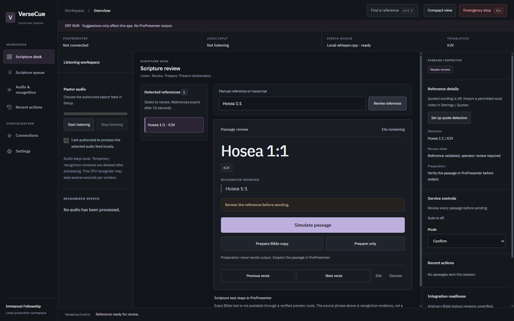

# VerseCue Studio workspace

2026-11-18 UTC. Version 0.6.0. The user selected Studio with Focus's clearer typography/spacing and requested a more premium, less generic appearance. NR-008's isolated concept comparison is complete; this document describes the real application implementation.

## Design and workflow

The full desktop arranges existing controls into a listening workspace, detected-reference list, central passage review and contextual inspector. The microphone authorization, level meter, start/stop and actual recognized text are accessible beside the Scripture desk. The same audio panel moves into its dedicated route when requested; no microphone or second recognition session is created by navigating.

Detected references use the real bounded session queue, with selection/expiry and the same no-output-on-selection behavior. Manual reference entry sits above the passage card. The main action retains its real Simulate/Show label; Bible-copy preparation and prepare-only are separate secondary actions, explicitly described as no output. Previous/next, edit and dismiss retain their existing backend behavior. The selected UI does not implement the conversational features still planned in docs/48-49.

The right inspector shows actual reference/review state, mode/Auto reason, recent receipts and integration limits. There is no fabricated live Bible preview, on-air indicator, connection, confidence score or current-passage claim. ProPresenter remains the authority for all Bible text, formatting, Looks and screens.

## Visual system

- Neutral graphite surfaces, subtle level changes, restrained lavender selection and one primary action. Red remains reserved for Stop; amber explains review/output cautions.
- Existing offline IBM Plex Sans, moderate heading weight, larger passage reference, consistent line-height and readable controls. No remote font, gradients, decorative quotation hero, oversized decorative badges or emoji icon set.
- A consistent original inline SVG navigation icon family, narrow borders, five-to-six-pixel control radii and aligned spacing. Icons are hidden from assistive technology; button text supplies accessible names.
- Settings keep their dedicated categories, clearer consent groups, safe defaults and all existing IDs/IPC contracts. No technical setting is silently changed by the layout.

## Responsive, keyboard and compact behavior

Wide screens show the listening/reference/review/inspector arrangement simultaneously. Smaller layouts stack or condense panels while preserving access to their real controls. Container queries account for text zoom as well as window width. Full/compact modes retain Stop, mode, scope labels and shared session state. Find a reference and Ctrl/Cmd+K focus the manual input; existing route shortcuts, explicit preparation shortcut and focused Enter/Space behavior remain local and unchanged.

Moving panels must not duplicate control IDs or listeners. `ui/studio.js` performs the one-time layout change before the existing workspace/application scripts bind controls. `ui/studio.css` supplies the selected visual system over the existing base stylesheet; `ui/workspace.js` coordinates the audio panel's route location. No backend connector, speech, parser, safety or data-retention implementation changed.

## Validation and acceptance limits

All 227 module regressions passed. Dedicated Studio checks verify unique control IDs, actual audio-panel movement across routes, manual review without output and horizontal fit at 1600/1280/900/640 pixels with 100% and 200% zoom. Initial checks caught a layout data-attribute collision and a zoomed status-label overflow; both were fixed before acceptance.

Existing source workspace, full/compact desktop, settings, typography, idle/focus stability, prepared-output fake-target and guarded-Auto checks passed. Matching Windows package checks and offline/minimized recognition evidence are recorded in the current build reports after completion. These tests use synthetic input or the previously authorized private fixture and do not establish actual microphone, ProPresenter output, macOS or live-service acceptance. P0 and the original remaining acceptance requirements stay PENDING.

The Windows artifact is a development build. Matching Mac native build/packaging must be verified separately; no platform success is inferred from a Windows screenshot. The isolated concepts remain available in `design-review/` as design history, without any production integration claims.

Delivery: [PR20](https://github.com/gboyegaadeojo/VerseCue/pull/20) merged. Windows0.6.0 verified134files; ZIP SHA256 `706af3f0f95e68dd6f357541e803312887a5a728db806a939ec50839e530dc0a`. Packaged Studio/desktop/offline speech/minimized quotes/prepared-output/Auto/renderer recovery checks all passed. Matching native Mac [run44330987454](https://github.com/gboyegaadeojo/VerseCue/actions/runs/44330987454) is queued; no native0.6.0 result inferred.
